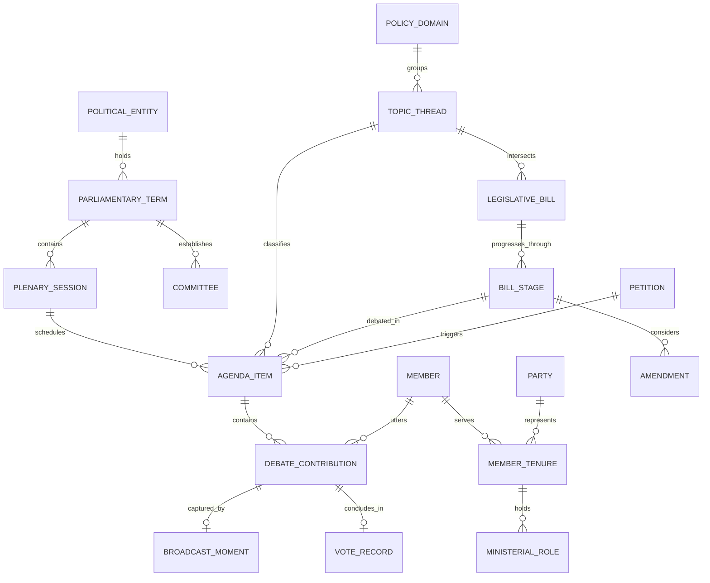
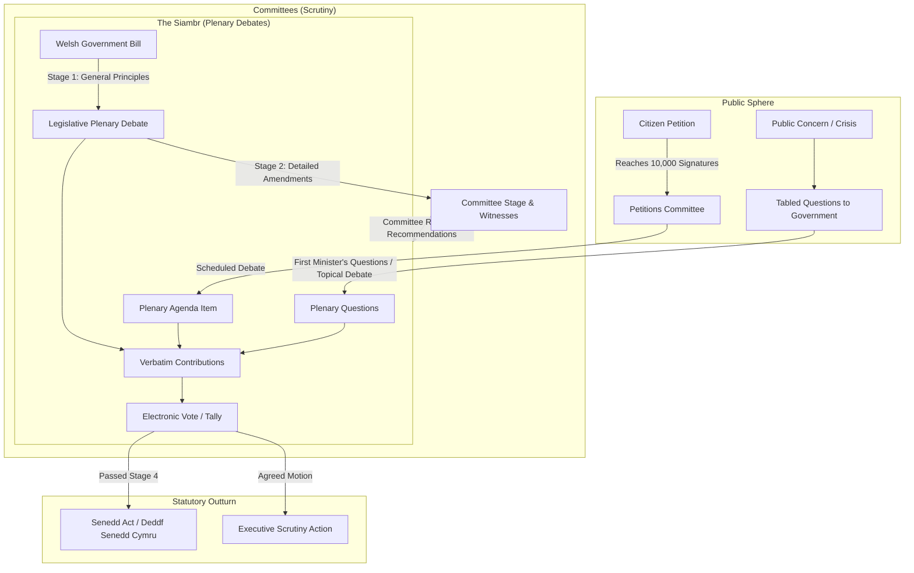

# Siambr — Domain Model & Information Architecture

> **Siambr** (Welsh: *Chamber*, pronounced `/ˈʃambər/`) is an interactive civic instrument mapping 25 years of democratic debate in the Senedd (Welsh Parliament / Senedd Cymru). It puts one sitting day of the chamber on a 3D stage, played back in real time from the official record, and keeps a plain Register of every Member and every contribution behind it.

---

## 1. Core Domain Entities

### Entity Definitions & Senedd Data Sources

| Domain Entity | Official Senedd Open Data Source | Provenance Classification |
|---|---|---|
| **`PlenarySession`** | `http://record.senedd.wales/XMLExport` (`<Meeting>`) | Verbatim official record |
| **`AgendaItem`** | `record.senedd.wales/XMLExport` (`<ItemTitle>`, `<ItemType>`) | Verbatim official record |
| **`DebateContribution`** | `record.senedd.wales/XMLExport` (`<Speaker>`, `<Paragraph>`) | Verbatim official transcript |
| **`Member` (MS / AS)** | `http://business.senedd.wales/mgwebservice.asmx` (`GetMembers`) | Canonical authority |
| **`MinisterialRole`** | `mgwebservice.asmx` (`GetMemberRoles`) | Canonical historical portfolio |
| **`LegislativeBill`** | `https://senedd.wales/legislation` (Crown XML) | Official legislative tracking |
| **`CommitteeInquiry`**| `mgwebservice.asmx` (`GetCommittees`, `<Minutes>`) | Official committee scrutiny |
| **`CitizenPetition`** | `https://petitions.senedd.wales/` JSON/RSS | Official parliamentary petitions |
| **`BroadcastMoment`** | `https://www.senedd.tv/` API / direct clip timestamp | Multimedia synchronization |
| **`TopicThread`** | Senedd Research Classifiers + Deterministic Topic Engine | Stated derivation with badge |

---

## 2. Parliamentary Lifecycle: The Web of Inner Machinations

---

## 3. The Sitting Day (The 3D Stage)

The stage shows one `PlenarySession`. The only spatial object is the chamber; the only axis is time.

### 3.1 The Chamber
- Procedural model of the real Siambr from the Senedd virtual tour and the 2026 refit sources. Desk count follows `parliamentary_terms.seat_count`.
- **Seating is derived.** No official seating plan is published. `assignSeats()` places contiguous party wedges and stamps `PROVENANCE_DERIVED`. The notice is always on screen.
- Y Llywydd presides from the dais, not a Member desk (`presiding_officers` table).

### 3.2 The Sitting Clock
- **`t`**: seconds from the start of the Senedd TV meeting clip. Each `DebateContribution.video_timestamp_start` is the `startPos` Senedd publishes on its own Senedd TV link, so `t` is an official figure.
- **Wall clock** = `plenary_sessions.meeting_start_time` + `t`.
- **Live contribution**: the timed contribution with the greatest `video_timestamp_start <= t`.
- **`t_end_derived`**: the next timed contribution's start. Derived, badged, never shown as a Senedd figure.
- **Untimed contribution**: no or negative `startPos`. Present in the running order and transcript; never drives the clock; plays as a fixed beat so it is not skipped.
- **Division window**: a `DivisionVote` on the current item, shown when `t` passes the last contribution before it and until the result has been displayed.

### 3.3 Floor State (what the chamber shows at time `t`)
| State | Trigger | Rendering |
|---|---|---|
| Floor light | live contribution has a seated Member | worktop glow, carpet pool, lit monitor at that desk |
| Dais light | live contribution is the Presiding Officer, a clerk, or unseated | Y Llywydd's desk lit, HUD names the record's speaker text |
| Spoken mark | Member has a contribution with start `< t` this sitting | warmed party tab |
| Division tint | inside a division window | desks tinted for / against / abstain; untinted when no vote recorded; wall clocks run |

**ChamberFloor** is the one module that answers "what does the chamber show at `t`": live beat, presiding officer, seats, live seat, live desk and division tint. Everything that draws the chamber or the HUD reads it; nothing re-derives the live desk. It returns the same state while only `t` moves, so the canvas renders only on change.

### 3.4 Camera
Guided by default with four vantage points (Gallery, Y Llywydd, Floor, Speaker) and a Follow toggle. Free walk is an opt-in using the first-person controller. Reduced motion: cuts, no walk.

---

## 4. The Register (2D)

- **Sittings index** (`/register`): sessions newest first, grouped by term, filters by term, domain, speaker.
- **Members** (`/members`, `/members/{id}`): the register of record for a Member. Every contribution grouped by sitting day with a *See it in the chamber* link to `/sitting/{date}?t=<start>`; every roll-call ballot.
- **Search** (`/search`): prebuilt client-side index over contributions and titles.
- **Stats** (`/sitting/{date}/stats`, `/terms/{n}/stats`): speaking time by Member and party, contributions per item, party by policy domain. All sums of the record, all badged `PROVENANCE_DERIVED`.

---

**Sitting record** is the one module every route loads data through. It decides what is fetched, when, and what enters the prerendered HTML; in the browser it caches recent sittings and terms. Prerendered sitting pages are shells: the sitting itself is fetched, never inlined.

---

## 5. The Drawers (Shared Seam)

Both surfaces open the same two drawers:
1. **Dossier Plate** (an agenda item): title, item type, domain (badged derived), Senedd TV link, verbatim speech stack, division plate, canonical citation.
2. **Member Plate** (a Member): portrait, roles, latest contributions, ballots, link to the Member page.

---

## 6. Currency

- `plenary_sessions.record_published_at` is the transcript's `dataroot@generated`. It is shown on the stage and the Register row.
- `pipeline.sync` re-fetches every sitting listed in the last 21 days on each run and replaces a session whole when its hash changes. Siambr never edits a record between Senedd publications.
- `sync_runs` records each run for the site footer ("Last checked 21:40 UTC").
