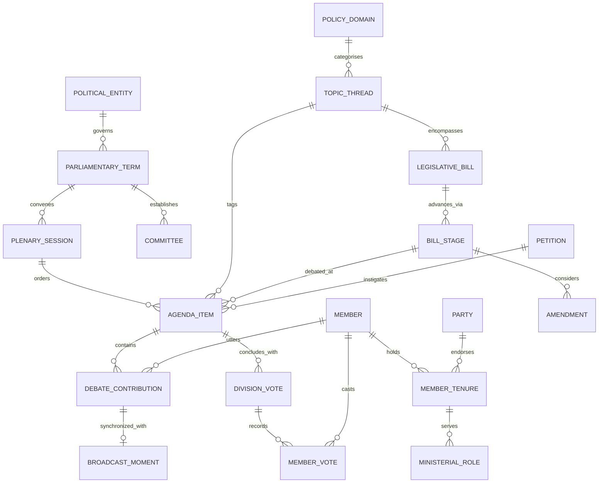

# Siambr — Master Technical & Architectural Specification
**System Document Reference: `siambr-spec.md`**  
**Version:** 2.0.0  
**Status:** Approved Architectural Baseline (supersedes 1.0.0-PROD; corridors and plinths withdrawn 2026-09-20)  
**Workspace:** `C:\Users\benbu\OneDrive\Desktop\Projects\SenTalky`  

---

## Table of Contents
1. [Executive Charter & Mission](#1-executive-charter--mission)
2. [Complete Domain Ontology & Data Models](#2-complete-domain-ontology--data-models)
3. [Official Senedd Open Data Integration Contracts](#3-official-senedd-open-data-integration-contracts)
4. [The Chamber Stage: One Sitting Day in 3D](#4-the-chamber-stage-one-sitting-day-in-3d)
5. [The Two Surfaces: Stage and Register](#5-the-two-surfaces-stage-and-register)
6. [Design System: The Senedd Estate](#6-design-system-the-senedd-estate)
7. [Editorial Standards & Prose Charter](#7-editorial-standards--prose-charter)
8. [Data Pipeline: Bronze, Silver, Gold, Static](#8-data-pipeline-bronze-silver-gold-static)
9. [Entry, Wayfinding & Kiosk](#9-entry-wayfinding--kiosk)
10. [System Architecture, Directory Layout & Testing Gates](#10-system-architecture-directory-layout--testing-gates)

---

## 1. Executive Charter & Mission

### 1.1 Creative North Star: The Sitting Day
Parliamentary democracy should be transparent, accessible, and dignified. Traditional parliamentary records—thousands of pages of Hansard, disconnected voting records, and a video archive nobody scrubs—alienate citizens and obscure who actually stands up and speaks.

**Siambr** (Welsh: *Chamber*, pronounced `/ˈʃambər/`) puts one sitting day of Senedd Cymru on a stage. The visitor picks a plenary day, presses Play, and watches the chamber come alive in real time: the desk of whoever holds the floor lights up, their verbatim words scroll beside the chamber, the clock on the wall shows sitting time, and divisions colour the desks. Behind the stage sits a plain, publication-grade **Register**: every Member, every contribution, every roll-call, linkable and searchable.

The two questions Siambr answers: *who speaks, when, about what* and *where do I find what my Member said*.

### 1.2 The Non-Negotiable Democratic Charter
Directly inheriting the rigorous provenance philosophy of [`datamapuk`](file:///C:/Users/benbu/OneDrive/Desktop/Projects/datamapuk):
1. **Zero Invented Statements**: Siambr never synthesises, calculates, hallucinates, alters, or attributes a parliamentary speech or division vote. Every word presented as a speech is a verbatim transcription from the official Record of Proceedings (*Y Cofnod*).
2. **Absence as an Honest State**: If a session was unrecorded, if a vote was an unminuted voice vote (*acclamation*), if a translation was not published, or if a contribution carries no broadcast timestamp, the interface reports the absence plainly. Gaps are never concealed with filler text or guessed defaults.
3. **Relocatability to Canonical Source**: Every sitting, contribution, Member page and division carries a direct hyperlink to the official record at `senedd.wales`, `record.senedd.wales` or `senedd.tv`.
4. **Separation of Fact and Synthesis**: Seating positions, speaking-time totals, party shares and any topic grouping are derived by Siambr and are visually isolated and badged `PROVENANCE_DERIVED` (*"Arranged by Siambr engine — speeches verbatim"*).
5. **Currency is Honest**: A sitting shows the timestamp at which Senedd published the record Siambr is displaying. When Senedd revises a record, Siambr replaces it whole and the timestamp moves. Siambr never edits a record between publications.

---

## 2. Complete Domain Ontology & Data Models

### 2.1 Entity Relationship Diagram



### 2.2 Relational Entity Schema (`data/siambr.db`)

#### `members` (Canonical MS/AM Registry)
Represents all 60 Members of the Senedd (and historical Assembly Members 1999–2020), with forward readiness for the 96-member expansion in 2026.
```sql
CREATE TABLE members (
    id TEXT PRIMARY KEY,                       -- e.g. 'ms-mark-drakeford'
    gss_constituency_code TEXT,                -- ONS GSS code (e.g. 'W09000008' Cardiff West)
    constituency_name_en TEXT NOT NULL,
    constituency_name_cy TEXT NOT NULL,
    canonical_name TEXT NOT NULL,
    honorific TEXT,
    portrait_url TEXT,
    official_profile_url TEXT NOT NULL,
    current_status TEXT CHECK(current_status IN ('active', 'former', 'deceased'))
);
```

#### `member_tenures` & `ministerial_roles`
Tracks party allegiance shifts and executive cabinet portfolios across all six Senedds.
```sql
CREATE TABLE member_tenures (
    id INTEGER PRIMARY KEY AUTOINCREMENT,
    member_id TEXT NOT NULL REFERENCES members(id),
    party_id TEXT NOT NULL,                    -- 'labour', 'plaid_cymru', 'conservatives', 'libdems', 'independent'
    senedd_term INTEGER NOT NULL CHECK(senedd_term BETWEEN 1 AND 7),
    is_regional_member BOOLEAN NOT NULL DEFAULT 0,
    region_name TEXT,
    start_date TEXT NOT NULL,
    end_date TEXT
);

CREATE TABLE ministerial_roles (
    id INTEGER PRIMARY KEY AUTOINCREMENT,
    member_id TEXT NOT NULL REFERENCES members(id),
    title_en TEXT NOT NULL,                    -- e.g. 'First Minister of Wales'
    title_cy TEXT NOT NULL,                    -- 'Prif Weinidog Cymru'
    cabinet_level TEXT CHECK(cabinet_level IN ('first_minister', 'cabinet_secretary', 'deputy_minister', 'counsel_general')),
    start_date TEXT NOT NULL,
    end_date TEXT
);
```

#### `plenary_sessions` & `agenda_items`
Directly parsed from official Plenary XML releases.
```sql
CREATE TABLE plenary_sessions (
    id TEXT PRIMARY KEY,                       -- e.g. 'plenary-2024-05-14'
    senedd_term INTEGER NOT NULL,
    session_date TEXT NOT NULL,                -- ISO 8601 YYYY-MM-DD
    title_en TEXT NOT NULL,
    title_cy TEXT NOT NULL,
    presiding_officer_id TEXT REFERENCES members(id),
    source_xml_url TEXT NOT NULL,
    xml_sha256 TEXT NOT NULL,
    record_published_at TEXT,                  -- dataroot@generated from the transcript XML; moves on every revision
    meeting_start_time TEXT                    -- HH:MM:SS from <MeetingDate>; anchors the sitting clock
);

CREATE TABLE sync_runs (                       -- one row per pipeline.sync invocation
    id INTEGER PRIMARY KEY,
    started_at TEXT NOT NULL,
    finished_at TEXT,
    sessions_changed INTEGER NOT NULL DEFAULT 0,
    error TEXT
);

CREATE TABLE agenda_items (
    id TEXT PRIMARY KEY,                       -- e.g. 'item-2024-05-14-04'
    session_id TEXT NOT NULL REFERENCES plenary_sessions(id),
    item_order INTEGER NOT NULL,
    item_type TEXT NOT NULL,                   -- 'debate', 'oral_questions', 'statement', 'bill_stage', 'emergency_debate'
    title_en TEXT NOT NULL,
    title_cy TEXT NOT NULL,
    policy_domain_id TEXT NOT NULL,            -- 'health', 'transport', 'economy', 'education', 'communities', 'devolution'
    senedd_tv_clip_id TEXT,
    senedd_tv_clip_url TEXT,
    origin_type TEXT CHECK(origin_type IN ('government_business', 'committee_report', 'petition', 'member_motion')),
    origin_ref_id TEXT                         -- e.g. petition ID or bill ID
);
```

#### `debate_contributions` (Verbatim Hansard Speeches)
```sql
CREATE TABLE debate_contributions (
    id TEXT PRIMARY KEY,                       -- e.g. 'contrib-2024-05-14-04-012'
    agenda_item_id TEXT NOT NULL REFERENCES agenda_items(id),
    member_id TEXT REFERENCES members(id),     -- NULL when the Record attributes the speech to no Member
    speaker_name TEXT,                         -- the publisher's own label for that speaker
    speaker_role TEXT,                         -- their job title as the Record gives it ('Counsel General')
    sequence_number INTEGER NOT NULL,
    spoken_language TEXT NOT NULL CHECK(spoken_language IN ('cy', 'en')),
    verbatim_text_original TEXT NOT NULL,      -- Exact spoken words
    verbatim_text_english TEXT NOT NULL,       -- Official Hansard translation if spoken in Welsh
    video_timestamp_start INTEGER,             -- Milliseconds from clip start
    video_timestamp_end INTEGER
);
```

#### `division_votes` & `member_votes` (Electronic Division Tallies)
```sql
CREATE TABLE division_votes (
    id TEXT PRIMARY KEY,                       -- e.g. 'div-2024-05-14-01'
    agenda_item_id TEXT NOT NULL REFERENCES agenda_items(id),
    motion_text TEXT NOT NULL,
    votes_for INTEGER NOT NULL,
    votes_against INTEGER NOT NULL,
    votes_abstain INTEGER NOT NULL,
    result TEXT NOT NULL CHECK(result IN ('agreed', 'negatived'))
);

CREATE TABLE member_votes (
    division_id TEXT NOT NULL REFERENCES division_votes(id),
    member_id TEXT NOT NULL REFERENCES members(id),
    vote_cast TEXT NOT NULL CHECK(vote_cast IN ('for', 'against', 'abstain', 'did_not_vote')),
    PRIMARY KEY (division_id, member_id)
);
```

---

## 3. Official Senedd Open Data Integration Contracts

Siambr unifies the five primary Senedd data platforms via typed contract adapters:

```
┌─────────────────────────────────────────────────────────────────────────────────┐
│                           SENEDD OPEN DATA CONTRACTS                            │
├─────────────────────┬────────────────────────────────┬──────────────────────────┤
│ Service             │ Endpoint / Format              │ Ingestion Responsibility │
├─────────────────────┼────────────────────────────────┼──────────────────────────┤
│ Plenary XML Library │ record.senedd.wales/XMLExport  │ Verbatim speeches,       │
│                     │ Crown XML Schema               │ agenda items, timings    │
├─────────────────────┼────────────────────────────────┼──────────────────────────┤
│ Meeting Information │ business.senedd.wales/         │ Members, committees,     │
│ (Modern.Gov)        │ mgwebservice.asmx (SOAP/XML)   │ division roll-call votes │
├─────────────────────┼────────────────────────────────┼──────────────────────────┤
│ Legislation Library │ senedd.wales/legislation       │ Bills, Acts, amendments, │
│                     │ Crown XML                      │ statutory lifecycle      │
├─────────────────────┼────────────────────────────────┼──────────────────────────┤
│ Petitions Platform  │ petitions.senedd.wales/        │ Citizen signatures,      │
│                     │ JSON / RSS endpoints           │ threshold triggers       │
├─────────────────────┼────────────────────────────────┼──────────────────────────┤
│ Senedd TV Archive   │ senedd.tv/Meeting/Clip/        │ Broadcast video clips,   │
│                     │ REST JSON metadata             │ direct speech timestamps │
└─────────────────────┴────────────────────────────────┴──────────────────────────┘
```

### 3.1 Plenary XML Adaptation (`pipeline/adapters/plenary_xml.py`)
- **Historical Era Discrepancies**:
  - *1999–2007 (First & Second Assemblies)*: Legacy Assembly Hansard schema. Speakers identified via text substrings (`"Rhodri Morgan [The First Minister]:"`). Adapter normalizes speaker substrings into canonical member IDs.
  - *2007–2016 (Third & Fourth Assemblies)*: Transition XML format. Explicit `<Speaker Id="...">` introduced with bilingual attributes.
  - *2016–Present (Fifth & Sixth Senedds)*: Modern Crown XML with structured item GUIDs, official translation blocks, and broadcast media identifiers.

### 3.2 Modern.Gov Web Service Adaptation (`pipeline/adapters/moderngov.py`)
- Reads SOAP XML methods:
  - `GetMembersXml`: Historical and current member listings.
  - `GetCommitteesXml`: Scrutiny committee hierarchies and memberships.
  - `GetVotingRecordsXml`: Precise division voting tallies with member-level yeas and nays.

---

## 4. The Chamber Stage: One Sitting Day in 3D

The 3D surface is the Siambr debating chamber and nothing else. There are no corridors, plinths, wings or temporal depth. Time is not spatial; time is the clock.

### 4.1 The Chamber Model (Origin `(0, 0, 0)`)
Procedural model of the real Siambr, built from the Senedd virtual tour (Matterport `hC9XLKU7RQ6`, 2026 rescan) and the 2026 refit sources. Plan and tones live in `frontend/src/lib/3d/chamber/` and `materials.ts` and are already implemented; the remaining work is polish passes, not modelling.
- Oak-boarded well with the slate roundel, carpet ring, Y Llywydd's desk on a low platform with the mace slot, clerks' run with monitors.
- Concentric tiers of separate oak desk wedges, charcoal worktop inset, pop-up monitor, gooseneck microphone, party tab, high-back chair. Desk count follows `parliamentary_terms.seat_count` (60 fill three rows, 96 fill four).
- Charcoal acoustic wall between oak pilasters, cornice uplighters, four wall screens, two oak doors, **two red division clocks**.
- Cedar-slat gallery fascia under full-height glass, tiered public gallery, white downlight ring under the cedar bell and funnel throat.
- Seating is **derived** (`assignSeats()`, contiguous party wedges, `PROVENANCE_DERIVED`). The notice is always visible on the stage.

### 4.2 The Sitting Clock
Every stage shows exactly one plenary sitting (`plenary_sessions` row). Playback is driven by a single scalar, **sitting time `t` in seconds from the start of the Senedd TV meeting clip**.
- Senedd's transcript XML gives each contribution `startPos` on the meeting-wide clip (`senedd.tv/en/{meeting_id}?startPos=N`). `video_timestamp_start = N`. The meeting `MeetingDate` carries the wall-clock start (for example `13:30:01`), so **wall clock = meeting start + t**. The division clocks on the chamber wall show this.
- A contribution is *live* while `start <= t < next.start`. `video_timestamp_end` is derived as the next timestamped contribution's start (or the item end) and badged derived; it is never presented as a Senedd figure.
- Contributions without a timestamp (procedural interjections, pre-sitting rows with a negative or missing `startPos`) are **untimed**. They appear in the running order and transcript but never drive the clock. An untimed run between two timed contributions plays as a fixed 4-second beat per contribution so nothing is skipped and nothing is invented.
- Transport: Play/Pause, speed 1x, 4x, 16x, next/previous contribution, next/previous agenda item, a scrub bar over the whole sitting with item boundaries marked. Keyboard: `Space` play, `Left/Right` contribution, `Shift+Left/Right` item, `[` and `]` speed.
- The playback engine is pure TypeScript (`$lib/stage/clock.ts`, `$lib/stage/timeline.ts`) with no Three.js dependency, unit-tested on fixture sittings.

### 4.3 Who Holds the Floor
- The live contribution's Member desk gets the **floor light**: worktop glow, a soft pool on the carpet, monitor lit. Y Llywydd's desk lights when the Presiding Officer or Deputy speaks.
- Desks of Members who have already spoken this sitting carry a faint **spoken mark** (a warmed party tab), so a glance across the chamber shows who has been up. A HUD option resets marks on item change; default off.
- If the live contribution has no seat (unknown Member, procedural text, clerk), the floor light goes to the dais and the HUD names who or what is speaking exactly as the record has it.
- On a division (`division_votes` linked to the current item and time), every desk tints for, against or abstain in the chamber's own semantics, not party colour; the wall division clocks run; the tally appears on the wall screens. Members without a recorded vote stay untinted. After the result, tints fade over 6 seconds.

### 4.4 Camera
Guided camera by default; free walk as an opt-in.
- **Guided**: the camera sits at one of four named vantage points. *Gallery* (default, above the public gallery looking at the dais), *Y Llywydd* (from the dais over the chamber), *Floor* (eye height in the western aisle), *Speaker* (three-quarter framing of whoever holds the floor, over their shoulder toward the dais). With *Follow* on, each speaker change eases the camera to re-frame the live desk; with *Follow* off it stays put. Click or tap any desk to frame it and open the nametag; click again for the Member page. Drag orbits and wheel zooms within limits so the chamber is never left.
- **Walk the floor** (toggle): the existing first-person controller in `controls/player.svelte.ts`, WASD or joystick, collision, `E` to open. Pointer lock only while walking. Never the default and never on a kiosk.
- `prefers-reduced-motion: reduce` replaces camera easing with cuts, removes the walk toggle, and offers the Register in one tap.

### 4.5 Engine Rules
- One Threlte scene, `@threlte/core/webgpu` Canvas with WebGL2 fallback; unchanged from v1.
- All per-desk visuals are instanced; floor light and division tints are per-instance colours, not extra meshes.
- 60 fps at 1440x900 on integrated graphics in the *Gallery* view with 96 seats is the performance gate.
- No network from the scene at runtime except the sitting's JSON and Member portraits.

---

## 5. The Two Surfaces: Stage and Register

```
[ Stage: /sitting/{date} ]  <---  shared data, shared drawers  --->  [ Register: /register, /members/{id} ]
```

### 5.1 Surface A: The Stage (3D)
- Route `/sitting/{YYYY-MM-DD}` with `?t=<seconds>` and `?item=<id>` for deep links. `/` lands on the latest sitting, paused at its first timed contribution.
- **HUD layout, desktop**: the chamber fills the viewport. A right-hand **transcript column** (36% width, minimum 22rem) shows the live contribution: Member portrait, name, party, constituency, ministerial title on that date, language tag, verbatim text scrolling at real pace, the official English translation under a Welsh original, and a *Watch this moment on Senedd TV* link at `startPos`. Below it the **running order**: agenda items with their contributions, the live one marked, click to jump. Top strip: sitting date picker, wall clock, transport, camera vantage buttons, walk toggle, Register link. Bottom-left: seating provenance notice and the record-published timestamp.
- **HUD layout, phone**: chamber above, transcript sheet below at 50% height, draggable to 90%; transport in the sheet header; running order as a second tab of the sheet.
- The transcript is verbatim and complete. It never paraphrases, trims or summarises.

### 5.2 Surface B: The Register (2D)
Pure SvelteKit, zero WebGL, publication-grade ledger following DESIGN.md.
- `/register`: sittings index, newest first, grouped by term, with filters (term, policy domain, speaker). Each item opens the Dossier Plate and carries a *Watch it play* link to the Stage at that item.
- `/members`: every Member of the current term, by party then name, with portrait, seat and roles; search by name; postcode lookup (browser-side call to postcodes.io, then match on `gss_constituency_code`; regional Members listed by region).
- `/members/{id}`: portrait, Welsh name, tenures, ministerial roles with dates, then **every contribution grouped by sitting day**, newest first, each with a *See it in the chamber* link to `/sitting/{date}?t=<start>`; then the roll-call divisions table. This is the register of record for "what did my Member say".
- `/search`: client-side full-text search over contributions and item titles from a prebuilt index (see 8.2). Results link to the Register item and to the Stage moment.
- `/sitting/{date}/stats` and `/terms/{n}/stats`: **derived** analytics, badged. Per sitting: speaking time by Member and by party (from timestamps), contributions per item, share of Welsh-language contributions. Per term: the same aggregated, plus contributions per party per policy domain. Every figure is a count or a sum of the record; nothing is modelled.

### 5.3 The Shared Seam: Drawers
Both surfaces open the same two drawers (`$lib/hud/Drawer.svelte`):
1. **Dossier Plate** (an agenda item): title, item type, domain (badged derived), Senedd TV link, verbatim speech stack, division plate, canonical citation.
2. **Member Plate** (a Member): portrait, roles, latest contributions, ballots, link to `/members/{id}`.

The Journey Track, curated Citizen Trails and quotation cards from v1 are withdrawn.

---

## 6. Design System: The Senedd Estate

### 6.1 Material Color Tokens

```css
:root {
  /* Ground & Surfaces */
  --color-ground: #F7F6F2;          /* Portland Limestone ground stock */
  --color-panel: #ECEAE3;           /* Elevated stone panel */
  --color-border: #D1CEBE;          /* Hairline structural rule */
  
  /* Ink & Typography */
  --color-ink: #16191D;             /* Welsh Slate ink for reading text */
  --color-body-text: #3F474F;       /* Secondary text */
  --color-muted: #65717C;           /* Captions & metadata */
  
  /* Senedd Estate Architectural Materials */
  --color-timber-cedar: #C87D4A;     /* Western Red Cedar timber wave */
  --color-timber-dark: #915025;      /* Aged structural timber */
  
  /* The Single Action Accent */
  --color-accent-plum: #C9187E;      /* Senedd Brand Plum (spent once per view) */
  --color-accent-plum-hover: #8F0D57;
  
  /* Night Chamber (3D Space & Dark Mode) */
  --color-ink-room: #111417;        /* Deep slate night room */
  --color-ink-room-raised: #191D22;
  
  /* Political Party Badges (Used in Dossier Plates only) */
  --color-party-labour: #D93B3B;
  --color-party-conservatives: #3B7BD9;
  --color-party-plaid: #329966;
  --color-party-libdems: #E59E2B;
  --color-party-independent: #7A828A;
}
```

### 6.2 The One-Accent Rule
`--color-accent-plum` (`#C9187E`) is spent strictly **once per view**: on the primary interaction button (e.g. *"Open Verbatim Dossier"*, *"Play Senedd TV Clip"*). Secondary actions use cedar timber or neutral stone rules.

### 6.3 Typography Hierarchy

| Role | Font Family | Size / Line Height | Purpose |
|---|---|---|---|
| **H1 Title** | `Lora, Georgia, serif` | `clamp(2rem, 5vw, 3.5rem)` / 1.08 | Chamber names, major plenary motions |
| **H2 Section** | `Lora, Georgia, serif` | `clamp(1.6rem, 3.2vw, 2.6rem)` / 1.12 | Agenda item titles, Senedd Acts |
| **H3 Subhead** | `DM Sans, sans-serif` | `1.15rem` / 1.3 | Speaker names, committee titles |
| **Body** | `DM Sans, sans-serif` | `0.95rem` / 1.65 | Verbatim Hansard speeches |
| **Figures/Data**| `JetBrains Mono, monospace` | `clamp(1.8rem, 4vw, 3rem)` / 1.0 | Voting divisions, session dates, timestamps |
| **Kicker** | `DM Sans, sans-serif` | `0.75rem` / `0.14em` tracking | Metadata badges, term indicators (`SIXTH SENEDD`) |

---

## 7. Editorial Standards & Prose Charter

Directly mirroring `datamapuk`'s `docs/editorial-standards.md`:

### 7.1 Tone of Voice
Plain, declarative, unhurried. Siambr is an instrument of democratic record, not a news tabloid or political blog.
- **Correct**: *"Debated on 14 May 2024. Motion agreed: 38 For, 16 Against."*
- **Forbidden**: *"A heated debate erupted where the minister faced fierce criticism."*

### 7.2 Verbatim Speech Integrity
- Transcripts are never abridged, summarized, or paraphrased within speech blocks.
- If a member speaks in Welsh, the native Cymraeg text is presented first, accompanied by the official parliamentary English translation.
- Punctuation, interjections (*"Hear, hear"*), and official reprimands from Y Llywydd are preserved verbatim.

### 7.3 Provenance Badging
Every card or dossier component displays an explicit provenance badge:
- `[OFFICIAL VERBATIM RECORD]`: Straight from Senedd Plenary XML, with the record-published timestamp.
- `[OFFICIAL DIVISION RESULT]`: Straight from Modern.Gov.
- `[ARRANGED BY SIAMBR]`: Seating positions and camera framing. Not the official seating plan.
- `[DERIVED FROM TIMESTAMPS]`: Speaking time, contribution end times, party shares. Sums of the record, nothing modelled.
- `[DERIVED TOPIC CLUSTER]`: Policy-domain grouping generated by Siambr; speeches verbatim.

---

## 8. Data Pipeline: Bronze, Silver, Gold, Static

```
[ Senedd Web Services ]
        |
        v
[ BRONZE ] --> data/bronze/plenary/{year}/{date}-{meeting}.xml   byte-for-byte mirror
        |      data/bronze/{moderngov,senedd_site,gov_wales}/...
        v
[ SILVER ] --> in-process normalisation (pipeline/plenary.py, members.py, divisions_petitions.py)
        |
        v
[ GOLD ]   --> data/siambr.db (SQLite WAL, FTS5)   the working store and the audit target
        |
        v
[ STATIC ] --> frontend/static/data/**.json        what the site ships; no server at runtime
```

### 8.1 Modules (`pipeline/`)
- `pipeline.ingest_plenary`: transcript XML by year, by ID range or by meeting ID; Bronze mirror; SHA-256; whole-session replace on hash change. Records the transcript's `dataroot@generated` as `plenary_sessions.record_published_at`.
- `pipeline.reconcile_members`: Modern.Gov, senedd.wales profiles, gov.wales titles.
- `pipeline.ingest_divisions_and_petitions`: Modern.Gov divisions into `division_votes` and `member_votes`, keyed to agenda items by date and order. Petitions stay optional and unlinked until data exists.
- `pipeline.sync`: **the one command the scheduler runs.** Idempotent. Lists the XMLExport index for the last 21 days, fetches every listed meeting fresh (Bronze cache bypassed inside that window), rewrites changed sessions, pulls divisions for changed dates, then runs `export` if anything changed. Writes a row to `sync_runs` (started, finished, sessions_changed, error). Exit 0 on no change.
- `pipeline.export`: Gold to Static. Deterministic: sorted keys, stable IDs, so an unchanged sitting produces a byte-identical file.
- `pipeline.run_checks`: verbatim audit, referential checks, provenance flags.
- `pipeline.check_health`: retrieval watchdog. Fails if the live index lists a meeting the export does not hold, whatever the cause; unattributed speech is reported, not failed. Run daily by `watchdog.yml`.
- `pipeline.bake_spatial_buffers` and the `spatial_plinths` table are **withdrawn**.

### 8.2 Static Data Contract (`frontend/static/data/`)
```
index.json                       terms, latest sitting date, generated_at
sittings/index.json              [{date, meeting_id, term, item_count, contribution_count, record_published_at}]
sittings/{date}.json             items[], contributions[] (id, item, seq, member_id, speaker_name, speaker_role,
                                 unattributed, lang, text_original, text_english, t_start, t_end_derived),
                                 divisions[] (with member votes), unattributed{contributions, speakers[]},
                                 clip_url, meeting_start_wallclock, record_published_at
members/index.json               current-term Members: id, names, party, seat, gss, portrait, roles (light)
members/{id}.json                full record: tenures, roles, contributions grouped by date
                                 (id, item title, t_start, text), ballots
terms/{n}.json                   seat_count, presiding officers, members[]
stats/sittings/{date}.json       derived speaking time by member and party, per-item counts   [PROVENANCE_DERIVED]
stats/terms/{n}.json             derived aggregates                                            [PROVENANCE_DERIVED]
search/index.json                prebuilt index over contributions and titles (minisearch or pagefind)
health.json                      last successful poll (checked_at, meetings listed/unavailable) and the
                                 unattributed speech count; read by the watchdog
```
A sitting file is fetched once per Stage load. Member files are fetched on demand. Nothing in the bundle depends on a server.

### 8.3 Scope and Backfill
- **Depth on the Seventh Senedd first.** Every plenary sitting from 12 May 2026, with timestamps and divisions. Earlier terms come later, contributions first.
- The XMLExport index lists only recent meetings. Backfill scans meeting IDs downward from the newest listed ID until `MeetingDate` leaves the term, keeps only plenary transcripts, runs once locally, and commits to Bronze.

### 8.4 Synchronisation Cadence (free tier)
- GitHub Actions `sync.yml`: cron every 30 minutes on Tuesday and Wednesday 13:00 to 23:00 UTC; once daily at 06:00 UTC otherwise; `workflow_dispatch` for manual runs.
- Job: checkout, `pipeline.sync`; if anything changed, `pipeline.export`, commit Bronze plus `siambr.db` plus static data, build SvelteKit with `adapter-static`, deploy to Cloudflare Pages. Unchanged runs finish in under a minute.
- Target latency: a sitting is on the site within one scheduler tick of Senedd publishing its transcript. Senedd's own publication latency is the floor and is outside Siambr's control.
- No alerting beyond the default Actions failure email.

---

## 9. Entry, Wayfinding & Kiosk

### 9.1 Front Door
`/` is the Stage on the latest sitting, paused at its first timed contribution, one Play button. Nothing else stands between the visitor and the chamber. The header offers *Find your Member* and *Register*.

### 9.2 Deep Links
- `/sitting/{date}?t=5120` opens the chamber at that moment, paused, camera on the speaker.
- `/sitting/{date}?item={id}` opens at the first timed contribution of that item.
- `/members/{id}` and `/register?item={id}` as in section 5.
These are the only permalinks. Every Register row and every Member-page contribution carries one.

### 9.3 Kiosk and Attract Mode
`?kiosk=1` (persisted in `localStorage`) enables:
- After 120 seconds idle, the camera drifts slowly between vantage points and playback runs the latest sitting at 1x with the transcript column visible. Any input stops the drift and shows the transport.
- Walk mode, pointer lock and external links are hidden; Senedd TV links become QR codes.
- After 10 minutes idle the sitting resets to its start so the next visitor sees the beginning.
Off by default on the public web.

---

## 10. System Architecture, Directory Layout & Testing Gates

### 10.1 Workspace Directory Layout

```
SenTalky/
|-- CLAUDE.md                   # Engineering conventions and commands
|-- DESIGN.md                   # The Senedd Estate design system
|-- DOMAIN_MODEL.md             # Entities and the sitting-day model
|-- PRODUCT.md                  # Vision, users, charter
|-- siambr-spec.md              # This document
|-- .github/workflows/sync.yml  # Poll, export, build, deploy
|-- backend/                    # FastAPI, DEV ONLY: serves siambr.db locally for inspection; not deployed
|-- pipeline/
|   |-- adapters/               # plenary_xml, moderngov, moderngov_divisions, senedd_site, gov_wales, petitions
|   |-- ingest_plenary.py  reconcile_members.py  ingest_divisions_and_petitions.py
|   |-- sync.py                 # scheduler entry point
|   |-- export.py               # Gold -> static JSON
|   `-- migrations/
|-- frontend/
|   |-- svelte.config.js        # adapter-static, prerender routes
|   |-- static/data/            # exported JSON (committed by sync)
|   `-- src/
|       |-- routes/             # /, /sitting/[date], /register, /members, /members/[id], /search, stats
|       `-- lib/
|           |-- 3d/chamber/     # model, layout, materials (kept)
|           |-- 3d/controls/    # player (walk mode), guided camera
|           |-- stage/          # clock.ts, timeline.ts, floor.ts: pure playback engine
|           |-- data/           # static JSON loaders and types (replaces lib/api)
|           |-- hud/            # Drawer, Dossier and Member plates, transcript column, transport, running order
|           `-- register/
`-- data/
    |-- bronze/                 # raw mirrors
    `-- siambr.db               # Gold
```

### 10.2 Quality & Verification Gates
1. **Verbatim Provenance Audit** (`python -m pipeline.run_checks`): a random sample of contributions from live XML diffed byte-for-byte against `siambr.db` **and** against the exported sitting JSON. Any drift fails.
2. **Timeline Invariants** (`vitest`): contributions sorted; `t_end_derived >= t_start`; untimed contributions never advance the clock; division windows lie inside their item.
3. **Provenance Badging**: tests parse routes and components; any derived figure (seating, speaking time, shares, domains) renders with the `PROVENANCE_DERIVED` badge.
4. **Prose Linter** (`scripts/check_prose.py`) against DESIGN.md.
5. **Accessibility** (`npm run test:a11y`): axe WCAG 2.2 AA on the Stage HUD, Register, Member page, Search and drawers; the reduced-motion path loads no three.js.
6. **Performance**: a Playwright trace of the Gallery view with a 96-seat term; the CI software-renderer floor is 30 fps, hardware target 60 fps.
7. **Export Determinism**: running `pipeline.export` twice on an unchanged database yields no diff.
